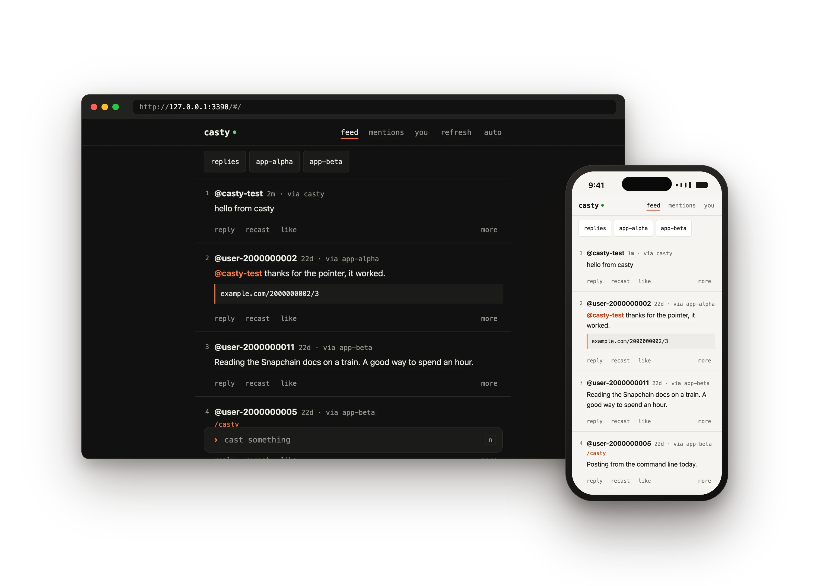
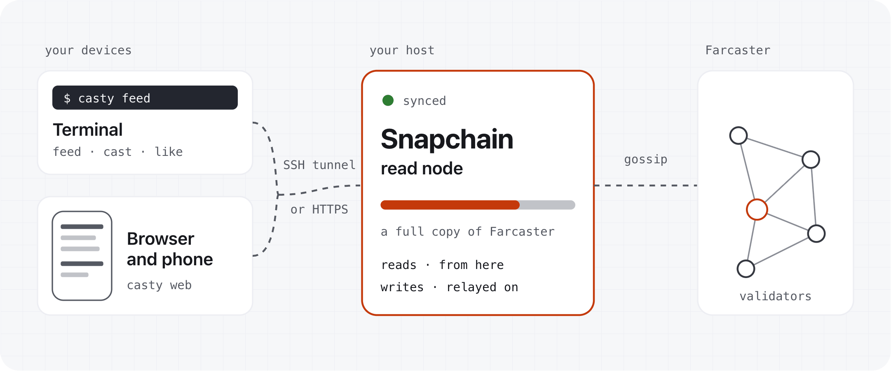
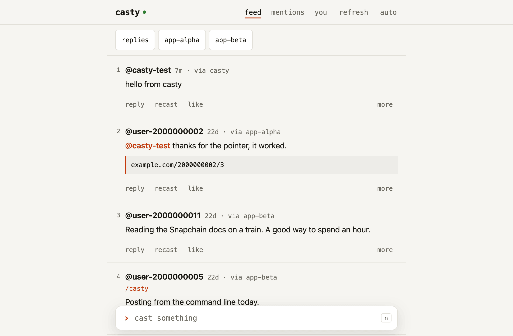
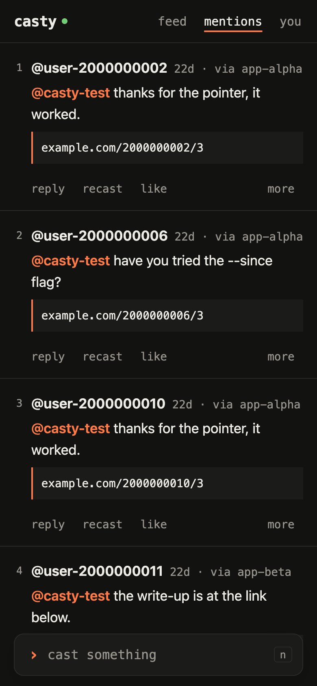
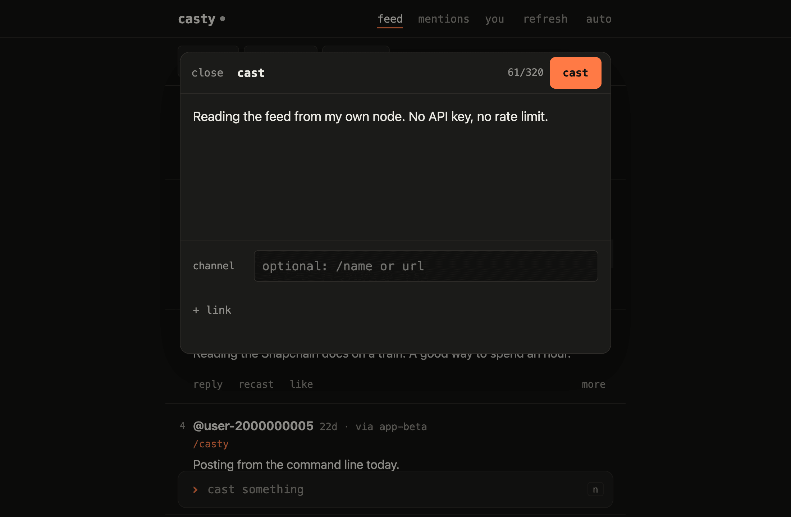
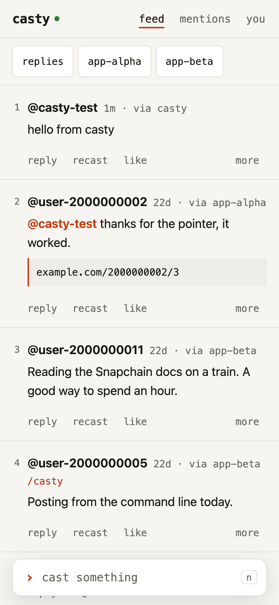

<div align="center">

# casty

**你自己的 Farcaster 只读节点，以及一个从它读取、通过它写入的客户端。**<br>
三条命令。不需要 API 密钥，不需要 Ethereum RPC，不需要 gas。

[](https://github.com/castyfun/casty/actions/workflows/ci.yml)
[](LICENSE)
[](https://castyfun.github.io/casty/)

[English](README.md) · [Русский](README.ru.md) · 中文 · [Español](README.es.md) · [Français](README.fr.md) · [العربية](README.ar.md)



**[网站和文档](https://castyfun.github.io/casty/zh-cn/)** · [全部命令](https://castyfun.github.io/casty/zh-cn/commands/) · [用智能体部署](https://castyfun.github.io/casty/zh-cn/agents/) · [llms.txt](llms.txt)

</div>

casty 在一台由你掌控的主机上放置一个 [Snapchain](https://snapchain.farcaster.xyz) 只读节点，即
Farcaster 的完整副本，并给你一个不与其他任何服务通信的客户端：一条终端命令，以及一个用于浏览器和
手机的页面。你的时间线、提及和会话从你的节点读取；你的 cast、回复、点赞、recast 和关注通过它发出。
为它们签名的应用密钥通过一条由你的钱包签署的消息添加：不需要交易，不需要 gas。

## 快速开始

你需要一个 Farcaster 测试账户的 fid，以及持有其托管地址的钱包；新建节点还需要 Hetzner 令牌、AWS 凭证，或一台有 16 GB 内存和 2 TB 可用磁盘的 Linux 主机。

在 Farcaster 应用中创建的账户，其托管地址保存在应用里，而不在浏览器钱包中：请在手机上的应用里查看恢复短语，并把它一次性导入 MetaMask 或 Rabby；或者不用 `casty web`，而是在你自己的终端里把它输入 `./bin/casty init`。

```sh
# a new node of your own
git clone https://github.com/castyfun/casty.git && cd casty
export HCLOUD_TOKEN=<token>            # Hetzner; or AWS credentials, or add -- --host user@ip below
./scripts/deploy.sh --fid <your fid>   # server, node (syncs for hours), ./bin/casty
./bin/casty web                        # open the link; under "you": "add a key with your wallet"
./bin/casty feed                       # read; ./bin/casty cast "hello" writes
./scripts/0-provision.sh --destroy     # when you are done: server, volume and firewall go
```

或者不自建节点，使用一个已在运行的节点：

```sh
# casty on a node that already runs
git clone https://github.com/castyfun/casty.git && cd casty
./scripts/2-client.sh --node https://snap.farcaster.xyz:3381 --fid <your fid>
./bin/casty web                        # open the link; under "you": "add a key with your wallet"
./bin/casty feed                       # read; ./bin/casty cast "hello" writes
```


## 用一条命令开始

### 一个属于你自己的新节点

```sh
git clone https://github.com/castyfun/casty.git && cd casty
./scripts/deploy.sh --fid <your fid> --domain node.example.org
```

`deploy.sh` 在 Hetzner（`HCLOUD_TOKEN`）或 AWS（AWS CLI 凭据）上租用一台带 2 TB 卷和防火墙的服务器，
安装 Snapchain 并等待它同步（数小时），在你的机器上安装 `casty`，并把页面以 HTTPS 放到主机上。
它会显示将要创建和计费的内容，只有在你确认之后才会继续。使用 `--fid` 时不需要输入助记词：在
`./bin/casty web` 提示时添加密钥，然后再次运行同一条命令，把页面放到主机上。
每一步都可以安全地重复运行：同一条命令会从上次中断的地方继续。你自己的一台有 16 GB 内存和 2 TB
可用空间的 Linux 机器也可以：加上 `-- --host user@ip`。

### 在已经运行的节点上使用 casty

```sh
git clone https://github.com/castyfun/casty.git && cd casty
./scripts/2-client.sh --node https://snap.farcaster.xyz:3381 --fid <your fid>
```

不需要服务器，也不需要等待：casty 连接任何 Snapchain 节点的 HTTP API，可以是你在另一台机器上的节点，
也可以是公共节点，并在之后的每条命令中记住它。然后运行 `./bin/casty web`，在 “you” 下按
“add a key with your wallet”。

### 让智能体来做

把[用智能体部署](https://castyfun.github.io/casty/zh-cn/agents/)中的提示词粘贴到
Claude Code、Codex、Cursor 或其他编程智能体中。它会阅读 [llms.txt](llms.txt)，询问你要两种方式中的
哪一种，在任何花钱的操作之前先给你看计划，并且从不索要你的助记词。

> 助记词掌控整个账户。casty 从不需要它：`--fid` 不用助记词即可完成设置，
> 密钥由你的钱包在 `casty web` 中批准。如果你确实要用助记词运行 `casty init`，
> 请使用测试账户，并且只把它输入到你信任的开发者所写的软件中。

## 各部分如何配合

<picture>
  <source media="(prefers-color-scheme: dark)" srcset="docs/src/assets/architecture-dark.png">
  
</picture>

读取来自你的节点，所以时间线的速度取决于运行它的机器。写入在你的机器上签名，由你的节点转发。
任何内容都不经过托管的 Farcaster API。

## 在笔记本电脑和手机上

<p>
  
  
</p>
<p>
  
  
</p>

`./bin/casty web` 在 `http://127.0.0.1:3390` 提供时间线、会话、提及、个人资料和撰写框，并打印一个
用于配对浏览器的链接；`--listen 0.0.0.0:3390` 会为同一网络中的手机加上二维码。
`./scripts/1-node.sh serve --domain <name>` 在节点主机上以 HTTPS 运行同一个页面，并为提及和回复
提供推送通知，所以手机可以从任何网络读写。

## 在终端中

```text
$ casty feed --limit 3
1  @casty-test · 0s · via casty
   Reading the feed from my own node. No API key, no rate limit.

2  @user-2000000002 · 22d · via app-alpha
   @casty-test thanks for the pointer, it worked.
   https://example.com/2000000002/3

3  @user-2000000011 · 22d · via app-beta
   Reading the Snapchain docs on a train. A good way to spend an hour.

$ casty like 2
liked 2000000002:0x973d398ad75e1f25fa780085f3c22d30b01d2504
```

| 命令 | 作用 |
| --- | --- |
| `./scripts/deploy.sh` | 依次运行第 0、1、2 步，使用 `--domain` 或 `--tailscale` 时还把页面放到主机上 |
| `./scripts/0-provision.sh` | 在 Hetzner 或 AWS 上的一台服务器、一个 2 TB 卷和一个防火墙，或用 `--host user@ip` 使用你自己的机器 |
| `./scripts/1-node.sh` | 主机上的 Snapchain、等待它同步、一条 SSH 隧道；`status`、`logs`、`upgrade`、`serve`、`down` |
| `./scripts/2-client.sh` | `./bin` 中的 `casty`（按发布版的校验和检查）、一个应用密钥、你的时间线 |
| `casty feed`、`mentions`、`thread` | 从你的节点读取，带有下一条命令可以使用的编号 |
| `casty cast`、`reply`、`like`、`recast`、`follow`、`delete` | 通过你的节点写入，读回之后才算确认 |
| `casty web`、`casty serve` | 页面，在本机或在主机上 |
| `casty doctor`、`whoami`、`key list`、`storage` | 节点的同步状态、你的账户、你的密钥、你的存储 |

[命令](https://castyfun.github.io/casty/zh-cn/commands/)讲解其中每一条命令及其选项；
每个脚本和命令也都接受 `--help`。

## 没有节点时

`test/mock-node` 中的模拟 Snapchain 节点用预置数据提供相同的 HTTP API，并检查提交给它的每条消息的
签名，因此整个客户端可以离线运行：

```sh
pnpm install --frozen-lockfile
pnpm demo       # a throwaway app key, the feed with and without one app, a cast, a like
pnpm demo:web   # the same, then casty web until Ctrl-C
```

预置数据使用 BIP-39 测试助记词 `test test test test test test test test test test test
junk` 和从 2000000001 开始的 fid，这些 fid 不属于任何人。

## 开发

```sh
make check                                       # lint, types, tests, shellcheck, bats, docs
pnpm --filter @casty/client test -- --coverage   # fails below 95 % of lines on client/src
pnpm --filter @casty/docs dev                    # the website at localhost:4321
```

`make check` 离线运行，除 Node 22.12+ 和 pnpm 外还需要 `shellcheck`、`jq` 和 `yq`（mikefarah）。
CI 在 Linux 上运行它，在 macOS 的 bash 3.2 上运行 shell 测试集，此外还运行 `pnpm audit` 和链接检查。
`client/test/e2e` 中针对真实节点的测试只在设置了 `CASTY_E2E_NODE_URL` 时运行。

| 路径 | 内容 |
| --- | --- |
| `scripts/` | 三个步骤、`deploy.sh` 和 `demo.sh`、它们的库和模板；bats 测试集在 `scripts/tests` |
| `client/` | `casty` CLI（TypeScript）和 `client/src/web` 中的 `casty web` 页面 |
| `test/mock-node/` | 模拟 Snapchain 节点及其预置数据生成器 |
| `docs/` | 网站和文档（Astro Starlight），六种语言 |
| `llms.txt` | 面向编程智能体的项目说明，附一条提示词完成设置的方法 |

[SECURITY.md](SECURITY.md) 列出了涉及的每一个机密、它存放的位置以及如何撤销，
以及如何报告漏洞。

## 许可

casty 以 [MIT 许可](LICENSE)发布。本仓库只包含 casty 自己的代码。
Snapchain 采用 GPL-3.0，不属于本仓库：`1-node.sh` 把 Snapchain 自己的 Docker 镜像和
compose 文件下载到你的主机上并在那里运行。每个发布版的单文件 `casty` 二进制文件内含
大约二十个 MIT 和 Apache-2.0 许可的软件包，它们的许可声明随附在旁边的
`THIRD_PARTY_LICENSES` 中。
