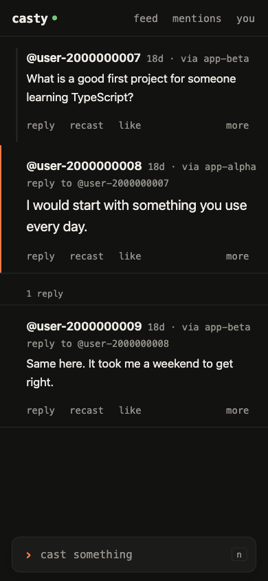

```sh
./bin/casty web
```

يطلب `casty web` كلمة مرور مخزن المفاتيح، ثم يقدّم صفحة على `http://127.0.0.1:3390` تقرأ من العقدة
نفسها التي تستخدمها الأوامر الأخرى وتكتب من خلالها. ويطبع رابطًا يحمل رمزًا مميزًا (token)؛ افتحه
لإقران المتصفح.

```text
casty web on http://127.0.0.1:3390
open to pair a browser: http://127.0.0.1:3390/#token=<43 characters>
Ctrl-C stops it; until then the app key stays unlocked in memory
```

لرؤيتها دون عقدة، يشغّل `pnpm demo:web` العقدة الوهمية، ويضيف مفتاحًا بعبارة الاختبار، وينشر منشورًا
واحدًا، ويقدّم الصفحة على منفذ حر إلى أن تضغط Ctrl-C.


## ما تفعله الصفحة

تضم الصفحة أوامر سطر الأوامر، بالأسماء نفسها.

| في الصفحة | في الطرفية |
| --- | --- |
| التغذية، مرقّمة: منشوراتك ومنشورات الحسابات التي تتابعها، الأحدث أولًا | `casty feed` |
| «mentions»: المنشورات التي تذكرك والردود على أحدث 25 منشورًا لك | `casty mentions` |
| المفاتيح فوقها: الردود مفعّلة أو معطّلة، ومفتاح لكل تطبيق | `--no-replies`، `--exclude-app` |
| النقر على اسم قناة: تلك القناة فقط؛ والنقر على المرشّح مجددًا: الكل | `--channel` |
| النقر على منشور: المنشور الذي يرد عليه، والمنشور، وردوده | `casty thread` |
| «reply» و«recast» و«like»، وفي «more»: الحذف، والفتح على farcaster.xyz، ونسخ الرابط | `reply`، `recast`، `like`، `delete` |
| `› cast something` في الأسفل: نص تصبح فيه @names إشارات ذِكر، وقناة اختيارية، وحتى رابطين | `cast --channel --embed` |
| النقر على اسم: منشورات ذلك الحساب، والتطبيقات التي ينشر عبرها، والمتابعة | `clients --fid`، `follow`، `unfollow` |
| «you»: معرّف fid الخاص بك، وعنوان الحفظ (custody address)، ومفاتيح التطبيق، والتخزين، والعقدة والساعة | `whoami`، `key list`، `storage`، `doctor` |
| تحت «you»، «add a key with your wallet» (مطويّ تحت «add another key» بعد أن يصبح لدى casty هذا مفتاح): مفتاح تطبيق جديد، تأذن به المحفظة في المتصفح | `casty init` مع عبارة البذرة |
| العناوين الموثّقة لملف شخصي، Ethereum أو Solana، مع النسخ | |
| مربع البحث تحت «you»: حساب بالاسم @name أو بمعرّف fid | `follow @name` |

تبقى المسودة في مربع الكتابة بعد إعادة التحميل، محفوظة في المتصفح بحسب ما ترد عليه، إلى أن يُرسَل
المنشور. تحمّل التغذية صفحتها التالية حين تظهر نهايتها، ويبقى زر «show more» للوحات المفاتيح. وعلى
الهاتف، يؤدي سحب التغذية إلى الأسفل من أعلاها ثم إفلاتها إلى تحديثها، إذ لا يوجد في الصفحة المثبّتة
شريط متصفح يُسحب.

كلما رسمت الصفحة التغذية أو الإشارات، حفظت ترتيبها كما يفعل `casty feed`، فيعمل `casty like 3` في
الطرفية على المنشور المرقّم 3 على الشاشة. آخر قائمة معروضة هي التي تُعتمد: متصفح آخر، أو `casty feed`
أو `casty mentions` أو `casty thread` في الطرفية، يعيد الترقيم.

## مفتاح تطبيق من محفظتك

يأذن عنوان الحفظ بمفتاح التطبيق بتوقيعين وفق EIP-712، هما طلب المفتاح وإضافة المفتاح؛ ويجعل
`casty init` عبارة البذرة توقّعهما. ويمكن للصفحة أن تجعل محفظة توقّعهما بدلًا من ذلك: تحت «you»، يطلب
«add a key with your wallet» من `casty web` مفتاحًا جديدًا والرسالتين، ويسلّمهما إلى المحفظة في المتصفح
(إضافة محفظة، أو الصفحة مفتوحة في المتصفح الخاص بتطبيق محفظة، `eth_signTypedData_v4` عبر EIP-1193)،
ويتحقق من أن حساب المحفظة هو عنوان الحفظ، ثم يعيد التواقيع؛ فيتحقق منها `casty web`، ويرسل `KEY_ADD` عبر
عقدتك، ويحفظ المفتاح، مشفرًا، بوصفه أحدث مفاتيحه. لا تغادر عبارة البذرة المحفظة أبدًا، وتعمل محفظة
عتادية خلف الإضافة بالطريقة نفسها.

للبدء دون أي عبارة، يكتب `casty init --fid <fid>` الإعدادات من العقدة، بما فيها عنوان الحفظ، ولا ينشئ
مفتاحًا؛ ثم يطلب `casty web` كلمة مرور للمخزن الذي يوشك على إنشائه، وتضيف الصفحة المفتاح الأول. تبقى
إزالة المفتاح في الطرفية (`casty key revoke`، بالعبارة أو بالمفتاح نفسه).

تجد الصفحة المحفظة بالطريقة التي تعلن بها المحافظ عن نفسها (EIP-6963)، فلا بأس بوجود عدة إضافات جنبًا
إلى جنب، و`window.ethereum` كبديل احتياطي. إن عرضت المحفظة حسابًا غير حساب الحفظ، تطلب منها الصفحة أن
تتيح لك اختيار الحساب الصحيح. تسمّي رسائل المفتاح شبكة Ethereum mainnet، لذا يُطلب من محفظة على Base
أو OP Mainnet أن تبدّل الشبكة أولًا (يرفض MetaMask التوقيع لسلسلة غير السلسلة النشطة)؛ والتبديل لا
يكلّف شيئًا. على هاتف لا محفظة في متصفحه، تعرض الصفحة روابط تفتحها داخل MetaMask أو Coinbase Wallet
أو Trust Wallet، وزرًا ينسخ رابط الإقران للصقه في الصفحة هناك، فيوقّع المتصفح الخاص بالمحفظة. لا تحمل
الروابط أي رمز: يذهب كل منها أولًا إلى خادم الجهة المصنّعة للمحفظة. والحساب الذي يكون حفظه عبارة
الاسترداد الخاصة بـ Farcaster من farcaster.xyz يمكنه استيراد تلك العبارة إلى أي من هذه المحافظ مرة
واحدة، ودون أن يكتبها في طرفية أبدًا.

يعرض الملف الشخصي العناوين التي وثّقها حسابه على أنها له، Ethereum أو Solana، من العقدة: كل منها يرتبط
بمستكشفه (لا يُفتح إلا عند النقر) ويمكن نسخه. وتُسرد عناوينك تحت «you» أيضًا. لا يُقرأ شيء من أي سلسلة.

لتبقى سريعة، تعيد الصفحة استخدام ما قرأته من عقدتك في آخر 30 ثانية حين تبدّل مرشّحًا، أو تعرض المزيد، أو
تعود إلى عرض ما. وأي شيء تكتبه من الصفحة يمسح ذلك، وكذلك التحديث، وإعادة تحميل الصفحة، والنقر على «feed»
أو «mentions» أو «you» وهو مفتوح؛ والمنشور الذي يُكتب في الطرفية يظهر عند التحديث التالي، أو عند تحميل
بعد أكثر من 30 ثانية. إعادة تحميل الصفحة تقرأ المنشورات مجددًا لكنها تأخذ قائمة متابعاتك من آخر عشر
دقائق؛ أما التحديث فيقرأها أيضًا، فيظهر الحساب الذي تابعته في تطبيق آخر فورًا.

ما دامت الصفحة مفتوحة، تسأل عقدتك كل دقيقتين، ومرة أخرى كلما عدت إليها، هل ذكرك أحد أو رد على أحدث 25
منشورًا لك منذ آخر نظرة. ويظهر الجواب رقمًا بجانب «mentions»، وفي عنوان علامة التبويب، وعلى أيقونة
الصفحة إن ثبّتّها كتطبيق وسمح المتصفح بذلك. فتح «mentions» يمسحه. وكذلك `casty mentions` في الطرفية، أو
فتح «mentions» في متصفح آخر: يتذكر casty أحدث ذِكر عُرض عليك، في مجلد إعداداته، لا في المتصفح. يبدأ العدّ
الأول من لحظة سؤال الصفحة أول مرة، فلا تُعدّ الإشارات السابقة لذلك جديدة أبدًا.

قبل أسبوع من انتهاء صلاحية مفتاح التطبيق لـ casty هذا، يذكر ذلك الإشعارُ تحت الشريط؛ وأي منشور أو إعجاب
أو متابعة يجدّده. يعدّ مربع الكتابة البايتات. بعد 320 يُرسَل المنشور كمنشور طويل، حتى 1024. تنتظر
الكتابة إلى أن تحصل العقدة على الرسالة، كما يفعل سطر الأوامر؛ وإن فشلت، تعرض الصفحة الرسالة والتلميح
نفسيهما اللذين كان سطر الأوامر سيطبعهما. النقطة بجانب casty هي عقدتك: خضراء حين تكون متزامنة، وكهرمانية
حين تتأخر، وحمراء حين لا تُجيب.

على لوحة المفاتيح: `n` منشور جديد، `r` تحديث، `j` و`k` للتنقل بين المنشورات، `l` إعجاب، `o` أو Enter
للفتح، Esc للإغلاق، Ctrl-Enter أو Cmd-Enter للإرسال.

الكلمة في أعلى اليمين تضبط السمة: auto تتبع النظام، وlight وdark تبقيان كما اختيرتا في ذلك المتصفح. على
الهاتف لا يتسع الشريط لها، ولا للتحديث: السمة تحت «you»، والنقر على «feed» أو «mentions» أو «you» وهو مفتوح
يعيد تحميله.



لا تحمّل الصفحة شيئًا من مواقع أخرى. لا تعرض صورًا ولا صورًا رمزية، والرابط في منشور لا يُفتح إلا حين
تتبعه.

## على الهاتف

```sh
./bin/casty web --listen 0.0.0.0:3390
```

يطبع هذا رابطًا لكل عنوان IPv4 يملكه الجهاز على شبكة، ورمز QR لأولها. امسحه بهاتف على الشبكة نفسها.
يمكن إضافة الصفحة إلى الشاشة الرئيسية فتُفتح عندئذ بملء الشاشة؛ وإن عرضت شاشة الإقران هناك، فالصق الرابط
فيها. يجب أن يبقى الجهاز قيد التشغيل و`casty web` يعمل.

الاتصال HTTP عادي. أي شخص يستطيع مراقبة حركة المرور على تلك الشبكة يمكنه قراءة الرمز والنشر باسمك
إلى أن توقف `casty web`. استخدم شبكة تثق بها، أو اربط الهاتف والجهاز بشبكة VPN مثل WireGuard واستمع على
عنوان VPN فقط. ولإبطال كل رابط طُبع من قبل، أوقف `casty web` وشغّله مجددًا مع `--new-token`.

يحتفظ المتصفح المقترن بالرمز لذلك العنوان والمنفذ، `http://192.168.1.20:3390` مثلًا. على شبكة أخرى
قد يعود العنوان نفسه إلى جهاز شخص آخر، والصفحة المفتوحة هناك من الشاشة الرئيسية ستسلّمه الرمز.
إن احتمل حدوث ذلك، فشغّل `casty web` مع `--new-token`.

فتح الرابط يضعه، مع الرمز، في سجل المتصفح، وفي سجله المتزامن إن كان المتصفح يزامن. امسح ذلك
الإدخال على متصفح تتشاركه مع غيرك.

يتخطى `--read-only` كلمة المرور. عندئذ تقرأ الصفحة ولا تستطيع الكتابة.

يوقف Ctrl-C `casty web`. الكتابة (منشور أو إعجاب أو إعادة نشر أو حذف أو متابعة) التي لا تزال تنتظر رسالتها
يُسمح لها بالانتهاء أولًا، وتذكر الطرفية ذلك؛ والضغط الثاني على Ctrl-C يوقفه فورًا.

للوصول إلى الصفحة من أي شبكة، لا من الشبكة التي عليها الجهاز فقط، شغّلها بدلًا من ذلك على مضيف العقدة
خلف HTTPS، حيث يمكن أن يصل الذِكر أو الرد إلى الهاتف أيضًا كإشعار دفع: [من أي شبكة](../serve/).

## كيف تُحمى الصفحة

- تستمع على 127.0.0.1 ما لم يحدد `--listen` غير ذلك.
- يحمل كل طلب API الرمز. يحمله الرابط بعد `#`، وهو ما لا يرسله المتصفح إلى خادم أبدًا؛ وتنقله
  الصفحة إلى تخزين المتصفح وتحذفه من شريط العنوان، حتى حين يُفتح الرابط في علامة تبويب تعرض الصفحة أصلًا.
- يوجد الرمز في `~/.config/casty/web-token`، بالصلاحيات 0600، فيبقى الهاتف المقترن مقترنًا بعد
  إعادة التشغيل.
- لا تُقبل الكتابات إلا بصيغة JSON، فلا يستطيع نموذج على موقع آخر النشر إلى الصفحة.
- يُرفض الطلب الذي لا تكون قيمة Host فيه عنوان IP أو `localhost` أو مضيف `--listen`، فلا يستطيع موقع
  يوجّه نطاقه الخاص إلى جهازك الوصول إلى الصفحة.
- لا تشغّل الصفحة إلا السكربت والأنماط الخاصة بها، وتُدرج نص المنشور كنص، لا كـ HTML أبدًا.
- ما دام `casty web` يعمل، يكون مفتاح التطبيق مفكوك التشفير في الذاكرة، كما يكون طوال مدة أمر
  `casty cast` واحد.

## الخيارات

```text
Usage: casty web [options]

the feed, threads and a compose box in a browser, on this machine or a phone

Options:
  --listen <host:port>     where to serve; 0.0.0.0:3390 lets a phone on the same
                           network in (default: "127.0.0.1:3390")
  --new-token              pair again; links printed before stop working
  --read-only              do not unlock the app key; the page reads but cannot
                           write
  --no-allow-fname-server  look @names up with your node only; by default names
                           it does not know are looked up on
                           fnames.farcaster.xyz (public, no key)
  -h, --help               display help for command
```
